# IoT Device Configuration & Compatibility Database

## Presentation & Viva Defense Guide (DBMS Level 3 Mini-Project)

**Academic Course:** DBMS Experiential Learning (Level 3 Mini-Project)**Team Number:** 9**Team Members:**

1. **Hitha Shree Suresh** (SRN: `PES2UG24CS196`)
2. **Hemant Ram Nelapati** (SRN: `PES2UG24CS192`)
   **Database System:** PostgreSQL 16.15 + `pgvector` v0.6.0
   **Database Name:** `iot_config_db`
   **Evaluation Paradigm:** Option 2 — SQL Database (PostgreSQL) + Vector Database (`pgvector`)

---

## Table of Contents

1. [Project Executive Overview](#1-project-executive-overview)
2. [Quick Reference Numbers (Must Memorize)](#2-quick-reference-numbers-must-memorize)
3. [Slide-by-Slide Presentation Script &amp; Timing (10-12 Minutes)](#3-slide-by-slide-presentation-script--timing-10-12-minutes)
4. [Team Division of Work &amp; Individual Contributions](#4-team-division-of-work--individual-contributions)
5. [Live Demonstration Script (Terminal Walkthrough)](#5-live-demonstration-script-terminal-walkthrough)
6. [Exhaustive Viva Voce Q&amp;A Cheat Sheet](#6-exhaustive-viva-voce-qa-cheat-sheet)
7. [The 4 Advanced Database Features (Rubric Defense)](#7-the-4-advanced-database-features-rubric-defense)
8. [Submission Deliverables Checklist](#8-submission-deliverables-checklist)

---

## 1. Project Executive Overview

### The Problem

The Internet of Things (IoT) hardware ecosystem is plagued by severe fragmentation:

- **Disparate Voltage Domains:** Microcontrollers operate at 3.3V or 5V, while modern low-power sensors operate at 1.8V or 3.3V. Connecting a 5V board (e.g., Arduino Uno) directly to a 3.3V sensor (e.g., BME280) causes electrical overstress and permanent hardware destruction unless a level shifter or pull-up resistor is used.
- **Protocol Mismatches:** Boards support varying hardware buses (I2C, SPI, UART) and wireless stacks (Wi-Fi, BLE, MQTT, LoRaWAN) with different pin assignments and native vs. simulated driver support.
- **Dispersed Documentation:** Wiring guides, driver library bindings, and pinout specs are scattered across GitHub repositories, vendor PDFs, and forums.

### The Solution

A unified, normalized relational database engine (PostgreSQL 16) coupled with an integrated vector database extension (`pgvector`):

1. **Relational Core (11 Tables in 3NF):** Accurately models hardware specifications, pin allocations, firmware releases, driver libraries, and multi-dimensional compatibility matrices with 50 catalog constraints enforcing physical laws.
2. **Vector Semantic Search (384-dimensional dense vectors + HNSW cosine index):** Enables natural language semantic discovery of unstructured configuration notes and troubleshooting guides directly inside SQL without requiring a separate vector database server.

---

## 2. Quick Reference Numbers (Must Memorize)

When the evaluator asks for project figures, state these exact numbers with confidence:

| Metric                                 |  Exact Value  | Explanation / Sub-breakdown                                                                                                 |
| :------------------------------------- | :-----------: | :-------------------------------------------------------------------------------------------------------------------------- |
| **Base Tables**                  | **11** | All normalized to Third Normal Form (3NF)                                                                                   |
| **Analytical Views**             |  **3**  | `v_device_compatibility_overview`, `v_device_protocol_summary`, `v_active_devices_catalog`                            |
| **Total Populated Rows**         | **81** | Exactly 81 rows across all 11 tables with zero orphaned foreign keys                                                        |
| **Total Constraints**            | **50** | **11** Primary Keys, **14** Foreign Keys, **8** Unique Constraints, **17** Domain CHECK Constraints |
| **Explicit Indexes**             | **15** | **14** B-Tree indexes + **1** HNSW vector cosine index (`CREATE INDEX`)                                       |
| **Total Catalog Indexes**        | **34** | 15 explicit + 19 constraint-backed indexes in `pg_indexes`                                                                |
| **Vector Dimension**             | **384** | Matches `sentence-transformers/all-MiniLM-L6-v2` dense vector space                                                       |
| **Stored Procedures / Triggers** |  **1**  | `trg_config_notes_updated_at` firing `fn_update_config_notes_timestamp()`                                               |
| **Pico W Protocol Count**        |  **6**  | BLE, I2C, MQTT, SPI, UART, Wi-Fi 802.11 b/g/n (4 native + 2 software stack)                                                 |

---

## 3. Slide-by-Slide Presentation Script & Timing (10-12 Minutes)

Use this structured breakdown during your presentation. Each team member speaks during their designated sections.

```mermaid
gantt
    title 12-Minute Mini-Project Presentation Flow
    dateFormat  m
    axisFormat %M min
    section Problem & Architecture
    Problem Statement & Hardware Motivation (Hitha) :0, 2m
    Database Architecture & ER Diagram (Hemant)     :2, 4m
    section Relational Design & DDL
    Normalization & 50 Constraints (Hitha)          :4, 6m
    Advanced Features & Vector Search (Hemant)      :6, 8m
    section Demonstration & Defense
    Live Terminal Evidence & Queries (Both)         :8, 10m
    Contributions & Viva Voce Defense (Both)        :10, 12m
```



---

### Slide 1: Title & Introduction (1 Minute) — *Speaker: Hitha Shree Suresh*

- **Script:**
  > "Good morning respected evaluators. We are Team 9. I am Hitha Shree Suresh (`PES2UG24CS196`), and my teammate is Hemant Ram Nelapati (`PES2UG24CS192`).
  >
  > Today, we present our DBMS Level 3 Mini-Project: the **IoT Device Configuration & Compatibility Database**.
  >
  > We implemented **Option 2** of the course guidelines: combining an enterprise relational database (PostgreSQL 16) with an integrated vector database (`pgvector`) within a unified, ACID-compliant database architecture."
  >

---

### Slide 2: Problem Statement & Engineering Motivation (1.5 Minutes) — *Speaker: Hitha Shree Suresh*

- **Key Points:**
  - IoT projects fail at the prototyping stage due to voltage incompatibility (e.g., 5V vs 3.3V) and mismatched driver libraries.
  - Traditional relational queries are great for filtering (e.g., finding boards with $\ge 2$ MB flash memory), but developers often need natural language help (e.g., *"How do I connect a BME280 sensor to an ESP32 without frying it?"*).
- **Script:**
  > "In the IoT hardware domain, engineers deal with dozens of microcontroller architectures, multiple operating voltages (1.8V, 3.3V, 5V), diverse communication buses, and disparate runtime environments like MicroPython and Arduino C++.
  >
  > A common mistake is connecting a 5V microcontroller directly to a 3.3V sensor, destroying sensitive ICs. Furthermore, troubleshooting guides and wiring notes are unstructured text.
  >
  > Our project solves this two-fold problem: a strict relational core prevents hardware mismatches through 50 constraints and multi-dimensional compatibility matrices, while an integrated vector search engine allows semantic retrieval of wiring and configuration notes."
  >

---

### Slide 3: Conceptual ER Diagram & Relational Mapping (2 Minutes) — *Speaker: Hemant Ram Nelapati*

- **Display Deliverable:** Page 1 of `9_Diagrams.pdf`.
- **Key Points to Highlight:**
  - **11 Entities:** Core entities (`DEVICES`, `COMPONENTS`, `COMMUNICATION_PROTOCOLS`, `MANUFACTURERS`, `DEVICE_TYPES`), software entities (`FIRMWARE`, `LIBRARIES`), configuration entity (`CONFIGURATION_NOTES`), and 3 associative entities (`DEVICE_PROTOCOLS`, `DEVICE_COMPONENTS`, `COMPATIBILITY`).
  - **Cardinalities:**
    - `DEVICES` to `COMMUNICATION_PROTOCOLS` is **Many-to-Many (M:N)** resolved via `DEVICE_PROTOCOLS`.
    - `DEVICES` to `COMPONENTS` is **Many-to-Many (M:N)** resolved via `DEVICE_COMPONENTS` (pinout mappings).
    - `COMPATIBILITY` is a **4-way associative matrix** linking `DEVICES`, `COMPONENTS`, `LIBRARIES`, and `FIRMWARE`.
- **Script:**
  > "Looking at Page 1 of `9_Diagrams.pdf`, our conceptual ER diagram models the domain with 11 entities. Notice how complex many-to-many relationships are cleanly decomposed:
  >
  > - Microcontrollers support multiple communication protocols, and protocols are implemented across multiple boards. This is resolved via the junction table `DEVICE_PROTOCOLS`.
  > - Physical wiring pinouts are mapped via `DEVICE_COMPONENTS`.
  > - Crucially, compatibility is not just a binary flag between a board and a sensor; it depends on the driver library and firmware version. Hence, `COMPATIBILITY` acts as a multi-way junction entity with composite uniqueness."
  >

---

### Slide 4: Relational Schema & 3NF Normalization (1.5 Minutes) — *Speaker: Hitha Shree Suresh*

- **Display Deliverable:** Page 2 of `9_Diagrams.pdf`.
- **Key Points to Highlight:**
  - **1NF:** Atomic attributes throughout. Protocol names, pinouts, and voltage tolerances are stored in dedicated rows/columns, never comma-separated strings.
  - **2NF:** All non-key attributes in composite-key junction tables (e.g., `is_native_support` in `device_protocols`) depend on the whole composite key.
  - **3NF:** Zero transitive dependencies. Manufacturer info is decoupled into `manufacturers`, categories into `device_types`, and runtime details into `firmware`.
  - **50 Integrity Constraints:** 11 PKs, 14 FKs, 8 UNIQUE, and 17 Domain CHECKs.
- **Script:**
  > "As shown on Page 2 of `9_Diagrams.pdf`, our physical relational schema adheres strictly to Third Normal Form. There are no transitive or partial dependencies.
  >
  > We implemented 50 integrity constraints in PostgreSQL:
  >
  > - 17 domain CHECK constraints guarantee valid physical ranges, such as `operating_voltage > 0 AND operating_voltage <= 48.0` and discrete enum states for `compatibility_status` and `tested_status`.
  > - 14 foreign keys enforce referential actions: we use `ON DELETE CASCADE` for parent-child dependencies, `ON DELETE RESTRICT` to protect master lookup tables, and `ON DELETE SET NULL` on `components.manufacturer_id` and driver libraries to preserve historical test records even if vendor records are purged."
  >

---

### Slide 5: Advanced Database Features & pgvector (2 Minutes) — *Speaker: Hemant Ram Nelapati*

- **Key Points to Highlight:**
  - We satisfy the rubric requirement of **at least 4 advanced features**:
    1. **Analytical Views (3):** E.g., `v_device_compatibility_overview` joining 6 tables to give a human-readable compatibility dashboard.
    2. **Automated Trigger & Stored Procedure:** `trg_config_notes_updated_at` fires `fn_update_config_notes_timestamp()` on `BEFORE UPDATE` to guarantee audit trail integrity.
    3. **Indexing Strategy (15 explicit):** 14 B-Trees on join keys/foreign keys + 1 HNSW index on embeddings.
    4. **Vector Database Semantic Search:** `pgvector` v0.6.0 with 384-dimensional dense vectors and HNSW cosine similarity (`<=>`).
- **Script:**
  > "To satisfy the Level 3 advanced database requirements, we implemented four distinct features:
  >
  > 1. Three analytical views that simplify complex 6-table joins for frontend consumers.
  > 2. An automated PL/pgSQL trigger that maintains tamper-proof `updated_at` audit timestamps.
  > 3. Fifteen explicitly created indexes for query acceleration.
  > 4. Integrated vector semantic search: in `configuration_notes`, we store 384-dimensional dense vectors indexed by an HNSW graph. Using PostgreSQL's cosine distance operator (`<=>`), developers can query troubleshooting guides using semantic intent rather than brittle keyword matching."
  >

---

### Slide 6: Live Terminal Walkthrough & DDL/DML Evidence (2 Minutes) — *Shared*

- **Display Deliverable:** `9_DDL.pdf` (Screenshots 1 through 10).
- **Walkthrough Highlights:**
  - **Screenshot 2:** DDL Schema Evolution (`ALTER TABLE components ADD COLUMN datasheet_url`).
  - **Screenshot 4:** Trigger demonstration showing automatic timestamp update upon note modification.
  - **Screenshot 7:** Complex DML aggregation: `GROUP BY` and `HAVING COUNT(dp.protocol_id) >= 4` showing ESP32, Pico W, and Uno Rev3.
  - **Screenshot 8:** Vector nearest-neighbor query retrieving relevant guides with calculated cosine similarity scores.
  - **Screenshot 9:** Transactional integrity: `DELETE` cascading test verifying `SET NULL` and `CASCADE` behaviors.
  - **Screenshot 10:** Complete database census proving 81 rows across all 11 tables.

---

### Slide 7: Conclusion & Summary (1 Minute) — *Speaker: Hitha Shree Suresh*

- **Script:**
  > "In conclusion, our project demonstrates a complete, production-grade implementation of a dual-paradigm database system:
  >
  > - 100% normalized relational integrity backed by 50 constraints and 81 verified records.
  > - Seamless AI vector search via `pgvector` HNSW indexing without the overhead of external vector servers.
  > - Full submission deliverables: `9_Diagrams.pdf` (strictly 2 pages), `9_DDL.pdf` (strictly 4 pages with 10 authentic screenshots), and synchronized `9_DDL.sql`.
  >
  > Thank you. We are now open for viva voce questions."
  >

---

## 4. Team Division of Work & Individual Contributions

The course guidelines require clearly defined responsibilities for both members. Present this exact division:

```
┌─────────────────────────────────────────────────────────────────────────────┐
│                       TEAM 9 DIVISION OF RESPONSIBILITY                     │
├──────────────────────────────────────────┬──────────────────────────────────┤
│ Hitha Shree Suresh (PES2UG24CS196)       │ Hemant Ram Nelapati (PES2UG24CS192)│
├──────────────────────────────────────────┼──────────────────────────────────┤
│ • Conceptual ER Diagram & Cardinalities   │ • PostgreSQL Database Architecture│
│ • Relational Normalization (1NF -> 3NF)  │ • pgvector Extension & HNSW Index│
│ • 50 Constraints (CHECK, UNIQUE, PK, FK) │ • PL/pgSQL Trigger & Procedure   │
│ • Analytical Views (3 complex views)     │ • DDL Evolution & ACID DELETE ops │
│ • Complex DML Queries (JOIN, GROUP BY)   │ • Execution Evidence (9_DDL.pdf) │
│ • Data Dictionary & Domain Specifications│ • Vector Retrieval Engine (<=>)  │
└──────────────────────────────────────────┴──────────────────────────────────┘
```

### Detailed Contribution Statements:

- **Hitha Shree Suresh (`PES2UG24CS196`):**

  > "My primary responsibility was the relational data modeling, schema normalization, and constraint architecture. I designed the conceptual ER diagram, decomposed complex many-to-many relationships into 3NF junction tables, and defined the 50 integrity constraints (including the 17 domain CHECK constraints enforcing electrical and protocol rules). I also designed the 3 analytical SQL views and authored the multi-table analytical DML queries including the HAVING aggregation."
  >
- **Hemant Ram Nelapati (`PES2UG24CS192`):**

  > "My primary responsibility was the database systems engineering, vector database implementation, and automated procedural logic. I configured PostgreSQL 16 and the `pgvector` v0.6.0 extension, implemented the HNSW vector index (`vector_cosine_ops`, `m=16`, `ef_construction=64`), and built the PL/pgSQL audit trigger function. I also executed the schema evolution (`ALTER TABLE`), benchmarked the ACID transactional deletion cascade, and generated the verified submission deliverables."
  >

---

## 5. Live Demonstration Script (Terminal Walkthrough)

If the evaluator asks you to execute queries live in `psql` or explain the screenshots in `9_DDL.pdf`, use this exact query guide:

### Demo 1: Table & Extension Inventory (`evidence/1.png`)

```sql
\dx pgvector
\dt
```

- **What to say:** *"Here we verify that the `pgvector` extension is active in PostgreSQL, and all 11 normalized base tables exist in the public schema."*

---

### Demo 2: Schema Evolution (`evidence/2.png`)

```sql
ALTER TABLE components ADD COLUMN datasheet_url VARCHAR(255);
SELECT column_name, data_type, character_maximum_length 
FROM information_schema.columns 
WHERE table_name = 'components' AND column_name = 'datasheet_url';
```

- **What to say:** *"Demonstrating DDL schema evolution: we added a `datasheet_url` column to `components` without dropping the table or losing data."*

---

### Demo 3: Constraint Verification (`evidence/3.png`)

```sql
SELECT conname, contype, pg_get_constraintdef(oid) 
FROM pg_constraint 
WHERE conrelid = 'compatibility'::regclass;
```

- **What to say:** *"Inspecting the `compatibility` table constraints. It has a composite unique constraint `uq_compatibility_matrix` across device, component, library, and firmware, plus CHECK constraints on allowed status enums."*

---

### Demo 4: Automated Trigger Audit Trail (`evidence/4.png`)

```sql
SELECT note_id, title, updated_at FROM configuration_notes WHERE note_id = 1;
UPDATE configuration_notes SET title = 'ESP32 I2C Sensor Bus Setup Guide (Updated)' WHERE note_id = 1;
SELECT note_id, title, updated_at FROM configuration_notes WHERE note_id = 1;
```

- **What to say:** *"Demonstrating our procedural trigger: when a configuration note is updated, `trg_config_notes_updated_at` automatically intercepts the operation and refreshes the `updated_at` timestamp with current `NOW()`."*

---

### Demo 5: Complex Analytical Views (`evidence/5.png`)

```sql
SELECT device_name, component_name, compatibility_status, requires_level_shifter 
FROM v_device_compatibility_overview 
LIMIT 5;
```

- **What to say:** *"This view abstracts a 6-table join across devices, components, manufacturers, libraries, and firmware into a clean, human-readable compatibility dashboard."*

---

### Demo 6: Multi-Table JOIN (`evidence/6.png`)

```sql
SELECT d.model_name AS device, c.component_name AS component, 
       comp.compatibility_status, comp.notes
FROM compatibility comp
JOIN devices d ON comp.device_id = d.device_id
JOIN components c ON comp.component_id = c.component_id
ORDER BY d.model_name;
```

- **What to say:** *"A relational inner join evaluating the hardware test matrix. Notice how the Arduino Uno + BME280 row specifies `REQUIRES_LEVEL_SHIFTER` due to the 5V vs 3.3V logic differential."*

---

### Demo 7: GROUP BY & HAVING Aggregation (`evidence/7.png`)

```sql
SELECT d.model_name, COUNT(dp.protocol_id) AS supported_protocols_count
FROM devices d
JOIN device_protocols dp ON d.device_id = dp.device_id
GROUP BY d.device_id, d.model_name
HAVING COUNT(dp.protocol_id) >= 4
ORDER BY supported_protocols_count DESC;
```

- **What to say:** *"Demonstrating advanced aggregation: this query groups protocol mappings by device and applies a `HAVING` clause to filter boards supporting at least 4 protocols. It returns ESP32 (6), Pico W (6), and Uno Rev3 (4)."*

---

### Demo 8: Semantic Vector Similarity Search (`evidence/8.png`)

```sql
WITH query_vector AS (
    SELECT embedding FROM configuration_notes WHERE note_id = 1
)
SELECT cn.note_id, d.model_name, cn.title,
       ROUND((1 - (cn.embedding <=> qv.embedding))::numeric, 4) AS cosine_similarity
FROM configuration_notes cn
CROSS JOIN query_vector qv
LEFT JOIN devices d ON cn.device_id = d.device_id
ORDER BY cn.embedding <=> qv.embedding
LIMIT 3;
```

- **What to say:** *"Demonstrating our vector database capability: using the `<=>` cosine distance operator, PostgreSQL computes nearest neighbors across dense 384-dimensional vector embeddings, sorting the most semantically relevant setup notes at the top."*

---

### Demo 9: Referential Integrity & Deletion Cascade (`evidence/9.png`)

```sql
BEGIN;
SELECT COUNT(*) FROM device_protocols WHERE device_id = 1;
DELETE FROM devices WHERE device_id = 1;
SELECT COUNT(*) FROM device_protocols WHERE device_id = 1;
ROLLBACK;
```

- **What to say:** *"Demonstrating ACID transaction safety and cascading referential integrity: deleting device 1 safely cascades to remove its dependent junction rows in `device_protocols` without leaving orphaned records, wrapped safely in a transaction block."*

---

### Demo 10: Complete Database Census (`evidence/10.png`)

```sql
SELECT 'Total Records' AS metric, 
       (SELECT COUNT(*) FROM communication_protocols) +
       (SELECT COUNT(*) FROM compatibility) +
       (SELECT COUNT(*) FROM components) +
       (SELECT COUNT(*) FROM configuration_notes) +
       (SELECT COUNT(*) FROM device_components) +
       (SELECT COUNT(*) FROM device_protocols) +
       (SELECT COUNT(*) FROM device_types) +
       (SELECT COUNT(*) FROM devices) +
       (SELECT COUNT(*) FROM firmware) +
       (SELECT COUNT(*) FROM libraries) +
       (SELECT COUNT(*) FROM manufacturers) AS total_rows;
```

- **What to say:** *"A complete catalog audit confirms exactly 81 rows populated across all 11 tables with zero foreign key violations."*

---

## 6. Exhaustive Viva Voce Q&A Cheat Sheet

Prepare these high-frequency evaluator questions:

### Q1: Why did your team choose Option 2 (SQL + Vector) instead of Option 1 (SQL + NoSQL)?

**Answer:**

> "IoT configuration data is inherently multi-relational—devices connect to components via strict electrical pinouts and protocol standards, which demands strict ACID compliance, relational integrity, and foreign key constraints. A document NoSQL store like MongoDB would introduce data duplication and lack schema-level voltage validation.
>
> However, IoT developers also need natural language search for troubleshooting guides and pinout specs. By choosing Option 2 with `pgvector`, we keep our relational data fully normalized while embedding semantic AI search inside the exact same PostgreSQL engine, avoiding the overhead of managing a separate database."

---

### Q2: Why use pgvector inside PostgreSQL rather than an external vector database like Pinecone, Milvus, or Chroma?

**Answer:**

> "Integrating `pgvector` directly into PostgreSQL provides three decisive engineering advantages:
>
> 1. **Zero Data Drift & ACID Transactions:** Updates to configuration notes and their embeddings happen in the same transactional commit. External vector databases suffer from sync lag and eventual consistency issues.
> 2. **Hybrid Relational + Vector Filtering:** We can perform hybrid queries in a single SQL statement—for example, filtering by `operating_voltage = 3.3` (relational) while simultaneously ranking by cosine similarity on semantic guides.
> 3. **Reduced Operational Overhead:** No separate vector cloud subscriptions, network latency, or duplicate backup pipelines."

---

### Q3: Explain how your database design achieves Third Normal Form (3NF).

**Answer:**

> "Our schema achieves 3NF through a systematic three-stage decomposition:
>
> - **1NF:** Every column contains atomic values. For example, pinouts and supported protocols are stored as individual rows in junction tables (`device_components`, `device_protocols`), never as delimited strings.
> - **2NF:** In all tables with composite primary keys (such as `device_protocols` on `(device_id, protocol_id)`), non-key attributes like `is_native_support` depend on the *entire* composite key, eliminating partial dependencies.
> - **3NF:** We eliminated all transitive dependencies ($X \rightarrow Y \rightarrow Z$). For instance, a device does not directly store manufacturer country or type category; it references `manufacturer_id` and `device_type_id`. Changing a manufacturer's details requires an update in exactly one place."

---

### Q4: Explain the difference between your foreign key deletion rules (`CASCADE`, `RESTRICT`, and `SET NULL`).

**Answer:**

> "We applied deletion rules based on strict domain semantics:
>
> 1. **`ON DELETE CASCADE`:** Applied to dependent child tables. If an IoT board is deleted from `devices`, its dependent pinout rows (`device_components`), protocol mappings (`device_protocols`), and configuration notes cascade automatically because they cannot exist without the parent board.
> 2. **`ON DELETE RESTRICT`:** Applied to master dimension tables. You cannot delete a protocol (e.g., `I2C`) or device type if active boards are using it. PostgreSQL halts the deletion to protect reference integrity.
> 3. **`ON DELETE SET NULL`:** Applied to `components.manufacturer_id` and `compatibility.library_id`. If a third-party sensor manufacturer or driver library is deprecated or removed, the physical hardware test record remains historically valid—the foreign key simply becomes `NULL`."

---

### Q5: How do your composite unique constraints work? Give an example.

**Answer:**

> "Composite unique constraints enforce multi-column business logic:
>
> - In `firmware`, `uq_firmware_device_version_runtime` enforces `UNIQUE (device_id, version_tag, runtime_environment)`. A board can have multiple firmware versions, and different boards can have the same version tag (e.g., `v1.20.0`), but the same board cannot have duplicate releases for the same runtime environment.
> - In `compatibility`, `uq_compatibility_matrix` enforces `UNIQUE (device_id, component_id, library_id, firmware_id)`. This prevents duplicate bench test records for the exact same hardware/software combination."

---

### Q6: What embedding model is targeted, what is the vector dimension, and what metric is used?

**Answer:**

> "We target `sentence-transformers/all-MiniLM-L6-v2`, an established open-source sentence transformer that maps text to a **384-dimensional dense vector space**.
>
> The similarity metric is **Cosine Distance**, executed using the `<=>` operator in PostgreSQL. The cosine distance between two normalized vectors $\mathbf{u}$ and $\mathbf{v}$ is defined as:
>
> $$
> D_C(\mathbf{u}, \mathbf{v}) = 1 - \frac{\mathbf{u} \cdot \mathbf{v}}{\|\mathbf{u}\|_2 \|\mathbf{v}\|_2}
> $$
>
> Cosine similarity score is obtained as $1 - (\mathbf{u} \Leftrightarrow \mathbf{v})$."

---

### Q7: Are your seed vector embeddings generated by a live ML model or synthetic? (The Honest Academic Answer)

**Answer:**

> "In our lab seed dataset, the 384-dimensional vectors are **mathematically generated normalized test vectors** created using a deterministic PL/pgSQL routine in `seed_data.sql`.
>
> We explicitly made this design decision to ensure **100% offline reproducibility and zero external dependencies** during lab grading. Evaluators can clone the repository and run the schema on any fresh PostgreSQL instance without installing Python, PyTorch, or downloading 100 MB of HuggingFace model weights.
>
> The implementation genuinely proves `pgvector` storage, HNSW indexing, and SQL vector retrieval. In a production deployment, the exact same column is populated via inference from `all-MiniLM-L6-v2`."

---

### Q8: Explain how HNSW indexing works and what parameters you used.

**Answer:**

> "HNSW stands for **Hierarchical Navigable Small World**. It is an approximate nearest neighbor (ANN) search algorithm that structures vectors into a multi-layer graph:
>
> - The top layers contain sparse links for fast long-distance traversal across the vector space.
> - The bottom layers contain dense clusters for fine-grained local search.
>
> We created the index with:
> `CREATE INDEX idx_config_notes_embedding_hnsw ON configuration_notes USING hnsw (embedding vector_cosine_ops) WITH (m = 16, ef_construction = 64);`
>
> - `m = 16`: Specifies the maximum number of bidirectional connection links per node in the graph. 16 balances memory usage and search accuracy.
> - `ef_construction = 64`: Specifies the size of the dynamic candidate list during index construction. A higher number yields higher recall at the expense of index build time."

---

### Q9: What does your automated trigger do?

**Answer:**

> "Our trigger `trg_config_notes_updated_at` fires `BEFORE UPDATE ON configuration_notes` for every row. It executes the stored function `fn_update_config_notes_timestamp()`, which sets `NEW.updated_at = CURRENT_TIMESTAMP;`.
>
> This guarantees database-level audit compliance: developers or applications do not need to manually supply timestamp values, and timestamps cannot be bypassed by raw SQL updates."

---

### Q10: How many protocols does Raspberry Pi Pico W support in your database?

**Answer:**

> "The Raspberry Pi Pico W supports **6 protocols** in our database: BLE, I2C, MQTT, SPI, UART, and Wi-Fi 802.11 b/g/n (4 native hardware buses and 2 wireless networking stacks via the onboard CYW43439 chip).
>
> Our HAVING query filtering boards with at least 4 protocols returns ESP32 (6), Pico W (6), and Arduino Uno Rev3 (4)."

---

## 7. The 4 Advanced Database Features (Rubric Defense)

When the evaluator asks to verify your **4 advanced features**, present this slide/section:

```
┌─────────────────────────────────────────────────────────────────────────────┐
│                 RUBRIC REQUIREMENT: 4 ADVANCED DATABASE FEATURES            │
├──────────────────────────┬──────────────────────────────────────────────────┤
│ Feature 1:               │ 3 Analytical Views (v_device_compatibility_      │
│ Complex Views            │ overview, v_device_protocol_summary,             │
│                          │ v_active_devices_catalog)                        │
├──────────────────────────┼──────────────────────────────────────────────────┤
│ Feature 2:               │ PL/pgSQL function fn_update_config_notes_        │
│ Stored Procedures /      │ timestamp() and BEFORE UPDATE trigger            │
│ Triggers                 │ trg_config_notes_updated_at                      │
├──────────────────────────┼──────────────────────────────────────────────────┤
│ Feature 3:               │ 15 Explicitly created indexes (14 B-Tree on FKs/ │
│ Advanced Indexing        │ filters + 1 HNSW index on dense vector column)   │
├──────────────────────────┼──────────────────────────────────────────────────┤
│ Feature 4:               │ pgvector v0.6.0 extension, 384d vector space,    │
│ Vector Similarity Search │ HNSW cosine similarity distance search (<=>)     │
└──────────────────────────┴──────────────────────────────────────────────────┘
```

---

## 8. Submission Deliverables Checklist

Confirm that you have these 3 official submission files ready to display or submit:

1. **`9_Diagrams.pdf`** (Consolidated Diagrams PDF):
   - **Page 1:** Conceptual Entity-Relationship (ER) Diagram with high-contrast, magnified typography (13.5pt headers, 14pt cardinalities).
   - **Page 2:** Physical Relational Schema Diagram showing all 11 tables, PostgreSQL types, PKs, FKs, and referential arrows.
   - **Page Count:** Strictly **2 Pages**.
2. **`9_DDL.pdf`** (Consolidated Execution Evidence PDF):
   - Contains 10 authentic live student terminal screenshots (`evidence/1.png` to `10.png`) showing DDL creation, schema evolution, triggers, views, joins, HAVING query, vector search, ACID transaction, and row count audit.
   - **Page Count:** Strictly **4 Pages**.
3. **`9_DDL.sql`** (Consolidated DDL Script):
   - Canonical DDL script synchronized 100% with `database/schema.sql`.

---

*Presentation Guide compiled for Team 9 (Hitha Shree Suresh & Hemant Ram Nelapati).*
*All rights reserved — DBMS Experiential Learning Level 3 Mini-Project.*
